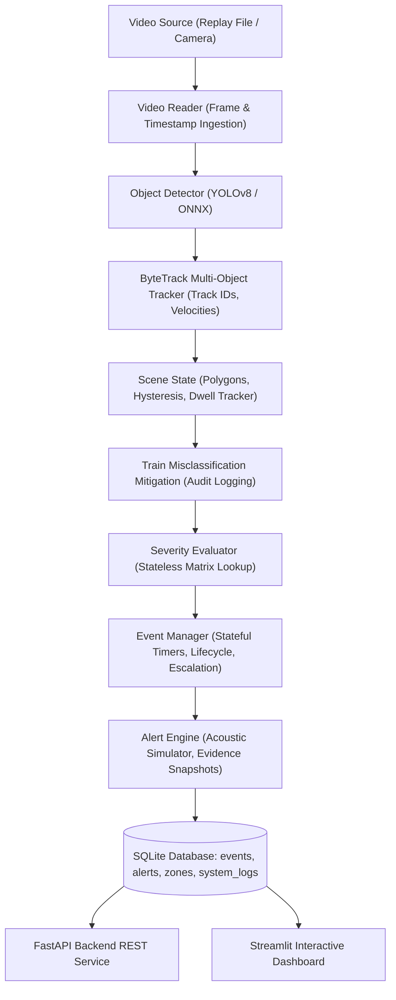

# System Architecture Specification (V3.1)

## High-Level Topology

## Detailed Component Specifications

### 1. Detection Layer
- Model: YOLOv8 Nano (`yolov8n.pt`, 3.15M parameters).
- Input: RGB / BGR image tensor ($640 \times 640$).
- Output: `DetectionResult(bbox, confidence, raw_class_name, rule_class)`.
- Coordinate validation: Coordinates clamped to $[0, W]$ and $[0, H]$. Inverted coordinates rejected.

### 2. Tracking Layer
- Algorithm: ByteTrack bipartite IoU matching with velocity smoothing.
- State: `TENTATIVE` (1 hit) $\to$ `CONFIRMED` ($\ge 2$ hits) $\to$ `LOST` (missed frame $\le 30$) $\to$ `DELETED`.
- Track ID preservation: Retains identity through occlusion up to 30 frames ($1.0\text{s}$ at $30\text{fps}$).

### 3. Scene State Layer
- Zones: Polygon boundaries defined via normalized $[0.0, 1.0]$ coordinates.
- Reference Point: Standard **bottom-center** coordinate:
  $$P_{\text{ref}} = \left(\frac{x_1 + x_2}{2}, y_2\right)$$
- Boundary Hysteresis: $1.5\%$ normalized window to prevent border oscillation.
- Dwell Tracking: Measures continuous time in zone using pipeline active clock.

### 4. Severity Evaluator (Stateless)
- Pure function: `(crossing_state, zone_type, rule_class) -> SeverityLevel`.
- Strict coverage: All 64 combinations pre-validated at initialization.
- Runtime fallback: Defaults to `HIGH` and writes audit log to database.

### 5. Event Manager (Stateful)
- Tracks unsafe-condition duration:
  - Begins when condition severity is $\ge \text{MEDIUM}$.
  - Resets when object exits danger or situation normalizes.
- Transitions:
  - `PENDING`: $T_{\text{unsafe}} < T_{\text{confirm}}$.
  - `CONFIRMED`: $T_{\text{unsafe}} \ge T_{\text{confirm}}$. Emits `INITIAL` alert.
  - `ESCALATED`: Severity increases or $T_{\text{unsafe}} \ge T_{\text{escalate}}$ after cooldown. Emits `ESCALATION` alert.
  - `RECOVERED`: Condition clears. Emits `RECOVERY` notification.
  - `CLOSED`: Track terminated.

### 6. Persistence & Relational Storage
- Engine: SQLite with WAL (Write-Ahead Logging) and foreign key constraints.
- Tables:
  - `events`: Unique event life cycle.
  - `alerts`: 1-to-many relationship with events (capturing initial, escalation, recovery alerts).
  - `zones`: Spatial polygon registry.
  - `system_logs`: Component diagnostic audit trail.
